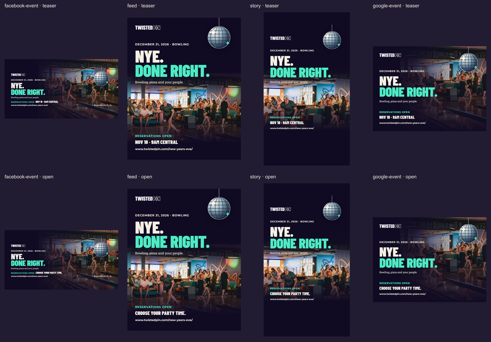

# NYE. Done right.

## Website link preview

The public NYE page uses [a dedicated 1200 × 630 JPEG](../../../public/og/og-nye-2026.jpg), rendered from the same approved code-native artwork. Its evergreen “Six party times” line makes no claim that reservations are open or inventory remains. Reproduce it with `node scripts/render-nye-og.mjs`; source/asset hashes and output dimensions are recorded in [share-card-manifest.json](share-card-manifest.json). This extra card does not replace the eight platform exports below. Sharing platforms may retain an older cached preview until they fetch the page again.

Review pack prepared October 22, 2026. **Eight rendered PNGs, editable artwork and ready-to-paste copy. No social posts or messages have been sent.** The top row is the reservations-opening teaser; the bottom row is the reservations-open version. The separate website link-preview JPEG is live with Website `6277c9f`; it is also copied into the Desktop pack's `03 - Website link preview` folder.

[Plain-text recommended copy](recommended-social-copy.txt) adds ready-to-paste Meta event, Google post/event, feed/Story and text-blast variants. Jon requested a delivery copy of all eight images plus the overview and this text file in the actual Windows Desktop folder `NYE 2026`; editable originals remain here. Desktop packaging does not publish or schedule a campaign.



Open [the local review gallery](review.html) for individual images, or use the export links below. [Copy and event settings](copy.md) contain the Facebook/Instagram posts, Facebook event description, Story captions, Google Update/Event copy and image accessibility text.

| Placement | Teaser | Reservations open | Export size |
| --- | --- | --- | --- |
| Facebook event landscape | [PNG](exports/facebook-event-teaser.png) | [PNG](exports/facebook-event-reservations-open.png) | 1920 × 1005 |
| Facebook / Instagram portrait feed | [PNG](exports/feed-teaser.png) | [PNG](exports/feed-reservations-open.png) | 1080 × 1350, 4:5 |
| Facebook / Instagram Story | [PNG](exports/story-teaser.png) | [PNG](exports/story-reservations-open.png) | 1080 × 1920, 9:16 |
| Google post landscape | [PNG](exports/google-event-teaser.png) | [PNG](exports/google-event-reservations-open.png) | 1200 × 900, 4:3 |

These dimensions are composition choices, not a claim that every placement requires them. Use the portrait feed asset for feed posts; do not rely on an automatic crop of the wide event cover. Use the teaser Google image in an **Update**, then the open image in an **Event**. Publishing-interface crop and overlay previews remain necessary, especially on Meta. The Story leaves generous empty space above and below the important content; this is a house margin, not a certified platform safe zone. Put its link sticker in the clear area below the printed URL and verify the actual overlay preview.

## Facebook event cover correction, October 22

Jon approved creating the Facebook event on November 18 when reservations open. Use `exports/facebook-event-reservations-open.png` for that event; the teaser remains available for pre-opening promotion. Both 1920 x 1005 covers now place all essential copy within a conservative central band, preserving the approved photograph, logo, Mirrorball and wording. Supporting copy stays at 32px or larger. The logo, URL and complete Mirrorball circle survive the centered approximately 2.7:1 crop observed in Jon's Jingle creation-dialog screenshot.

The renderer checks those bounds and writes 600px crop previews into `qa/`. These simulate that one creation-dialog crop; no Facebook event was uploaded, published or scheduled, and they are not a guarantee for every placement. Inspect Facebook's actual reposition preview before saving. Upload the full-size export, not the QA crop. The website share image and the six feed/Story/Google exports are unchanged. Updated copies replace the matching files in the Desktop `NYE 2026` phase folders and its overview image.

## Timing and factual basis

The teaser runs before **November 18, 2026, 9am Central** (`2026-11-18T15:00:00Z`). It shows the December 31 event date and the sales-opening time, with no party times or prices. Switch to the open version only once reservations have opened; this pack does not schedule or publish anything. Remove time-sensitive creative when it is no longer bookable. Availability and current purchasing rules remain on the reservation page.

The open event copy uses six separate parties on December 31: **11am–12:30pm, 1pm–2:30pm, 3pm–4:30pm, 5pm–7pm, 7:30pm–9:30pm, and 10pm–12:30am January 1**. A reservation covers its selected party time, not the entire event. The event's overall bounds are December 31 at 11am through January 1 at 12:30am, America/Chicago. Prices, drink inclusions, midnight-toast promises, coupons, scarcity claims and purchase-cutoff claims are omitted.

Source basis: released Website `1a5089125488694a9fe8105b3c782b6d357615c4`:

- [NYE landing page](../../../src/pages/new-years-eve.astro): party schedule, bowling/shoes/pizza/party favors, location and approved headline.
- [Opening policy](../../../src/config/nye-opening.ts): November 18, 9am Central opening and last-party end.
- [Mirrorball concept](../../../src/components/nye/HomepageEntranceOptions.astro): the selected Mirrorball drawing and “NYE. DONE RIGHT.” direction.
- [Voice](../../voice.md), [visual direction](../../visual-direction.md), [original identity reference](../../brand-guidelines.md) and [Website guidance](../../../CLAUDE.md): approved supplied logo and Website font substitutions. The September 8 generated guide was not used.

## Platform references checked October 22, 2026

| Official source | Verified guidance and its scope |
| --- | --- |
| [Google: create and manage Business Profile posts](https://support.google.com/business/answer/7342169?hl=en) | Updates support text, media and an action link. Events support a title, dates and times; when a start or end time is omitted, the interface can show a 24-hour event. Use an Update for the pre-opening teaser and explicit event times once public. |
| [Google: LocalPost API reference](https://developers.google.com/my-business/reference/rest/v4/accounts.locations.localPosts) | Event information has a start/end date and time interval; BOOK and LEARN_MORE are available call-to-action types. This documents API fields, not a claim that every interface is identical. |
| [Google: Business Profile photo guidance](https://support.google.com/business/answer/6123536?hl=en) | General photo guidance is JPG/PNG, 10 KB–5 MB, minimum 250 × 250, recommended 720 × 720. It does not prescribe a 4:3 event-post image. These PNGs satisfy the general size/file bounds; the 1200 × 900 crop is our composition choice. |
| [Google: Business Profile posts content policy](https://support.google.com/business/answer/7213077?hl=en) | Unverified contact information can cause removal. This pack uses the website action and omits phone numbers. It promotes bowling and the event without drink inclusions or alcohol claims. |
| [Meta: Facebook Feed image guide](https://www.facebook.com/business/ads-guide/image/facebook-feed), [Instagram Feed image guide](https://www.facebook.com/business/ads-guide/image/instagram-feed), [Stories guidance](https://www.facebook.com/business/help/2222978001316177) | Official pages were blocked/login-gated in this research environment. Current numeric limits and exact placement safe zones could not be verified. No third-party specification is represented as official. The supplied aspect ratios must be checked in the intended organic/ad/event publishing preview before use. |

## Editable source and reproduction

[artwork/campaign.html](artwork/campaign.html) owns composition, text styling and the inline Mirrorball SVG. [render-nye-marketing.mjs](../../../scripts/render-nye-marketing.mjs) owns the two phase lines, sizes, local asset embedding, export and review sheet. The renderer reads these existing repository assets without modifying them:

- `public/snap/nye-reserve-hero-1600.webp`: existing NYE reservation photograph, retained as the real bowling context.
- `public/logo/twisted-pin-horizontal-white.png`: supplied white wordmark, unchanged.
- Installed `@fontsource` files: Barlow Condensed 900 display, Montserrat 700 UI, Roboto Slab 400 body, matching the approved Website substitutions. No newly licensed font or external asset is introduced.

From the Website repository root, with its locked dependencies installed and the existing Playwright Chromium available:

```sh
node scripts/render-nye-marketing.mjs
```

The renderer reads no environment files, blocks browser network requests, writes only this campaign folder, and does not build or deploy the Website. It verifies font loading, image decoding, canvas bounds, conservative Story text bounds and a 5 MB per-image limit. It regenerates the eight PNGs, contact sheet, gallery and [export manifest](export-manifest.json), which records dimensions, checks and hashes. Actual final PNGs are kept beside the editable source; they are not hidden in an ignored cache. Existing photo/logo originals remain in their tracked repository paths, while dependencies remain ignored.

Visual review covers every exported layout and both phase lines. This is a static creative pack; platform compression/cropping, placement overlays, link buttons and publication scheduling still need the actual platform preview. No social account access or publication was attempted.
